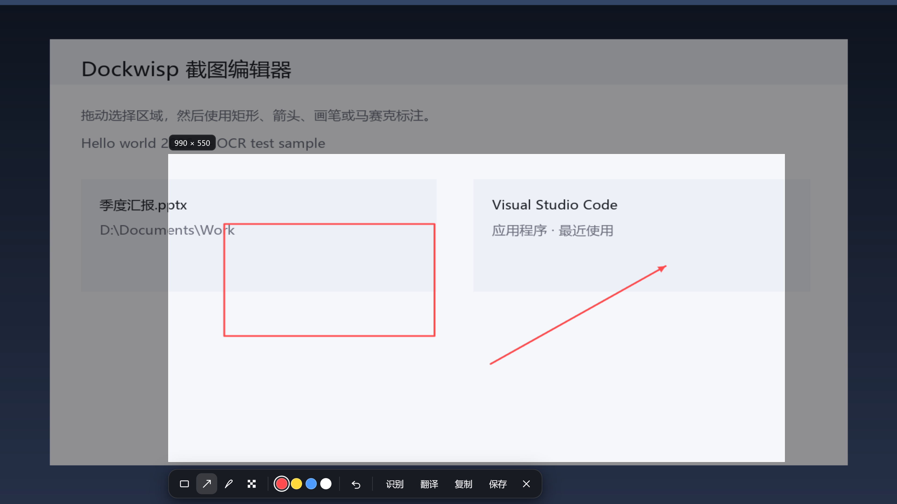

# Dockwisp

> 一个不登录、不催更新、核心功能离线也能用的 Windows 快捷启动器。

Dockwisp 把「找应用、搜文件、算数、翻译、截图、OCR、文件预览」收进一个输入框。它不要求账号，不推订阅，不强制更新，也不把常用功能拆成付费模块——装上就能用，用完就可以关掉。


## 为什么是 Dockwisp

常见启动器往往越做越重：登录、云同步、订阅、频繁更新、插件市场、通知弹窗。Dockwisp 选择相反的方向：

| | 常见同类工具 | Dockwisp |
| --- | --- | --- |
| 上手成本 | 注册账号 / 订阅 / 引导流程 | 安装即用，无账号、无登录 |
| 网络依赖 | 核心功能依赖云端服务 | 搜索、索引、截图、OCR、预览均在本机完成 |
| 更新策略 | 强制更新 / 频繁弹窗 | 不强制更新，版本由你决定 |
| 界面 | 功能面板层层堆叠 | 一个输入框，需要时才展开功能中心 |
| 工具组合 | 启动器、截图、OCR、预览分散在多个软件 | 截图 OCR、翻译、文件预览内置 |
| 扩展方式 | 绑定特定插件生态 | 兼容常见 `plugin.json` 插件模型，也支持离线插件包 |

除了在线翻译外，Dockwisp 的核心能力不依赖网络；翻译也可以切换到本地 LibreTranslate，做到完全离线使用。

## 一眼看懂

- `Alt+Space` 全局呼出，冲突时回退到 `Ctrl+Space`
- 单输入框启动器，结果向下展开，没有多余窗口装饰
- 浅色 / 深色 / 跟随系统三套半透明主题，可调面板透明度
- 按住搜索栏上下左右边缘或尾部图标拖动窗口，自动记住位置，可一键还原或禁止拖动
- 应用、文件、系统工具统一搜索：控制面板、注册表、终端、设备管理器、服务、磁盘管理、Windows 设置等
- 全盘文件搜索（Everything 引擎，内置便携版回退）
- 文件结果右键预览：图片、文本/代码、音频、视频、PDF
- `Alt+Shift+S` 区域截图：矩形 / 箭头 / 画笔 / 马赛克、OCR、翻译、复制、保存
- 全局长按中键取词翻译，支持 MyMemory 或 LibreTranslate
- 计算器、单位换算、汇率、JSON/Base64/时间戳/哈希/正则工具
- 可固定常用结果到主页，按使用频率排序
- 兼容常见插件 `plugin.json`、preload、`base/regex/over/files/img/window` 指令模型
- 支持标准 gzip-ASAR `.upx/.upxs` 离线插件包

## Dockwisp 中心

设置和插件不再是散落的弹窗，而是一个双栏功能中心：左侧是功能导航，右侧是插件卡片或设置页。插件页支持三列卡片和模糊搜索，后续可以继续增加新的功能页。


## 截图与 OCR

截图默认使用 `Alt+Shift+S`，可在设置中修改。框选后可标注、OCR、翻译、复制或保存。未选区时直接按 Enter 会复制全屏并关闭；点击“复制”同样会复制并退出。OCR 使用 Windows 原生 `Windows.Media.Ocr`，语言跟随系统用户配置。



## 文件搜索

文件搜索依赖 [Everything](https://www.voidtools.com/)：Dockwisp 通过 `native/bin/everything-search.exe` 调用 Everything SDK 查询全盘索引，速度通常在 100 ms 内。优先使用本机安装的 Everything；未安装时使用打包的便携版 Everything；不可用时回退到桌面、下载、文档和自定义目录的本地索引。

Everything SDK（`native/sdk`）按 MIT 许可分发，详见 `native/sdk/License.txt`。SDK 的二进制文件和便携版 `Everything.exe/.lng` 不提交到仓库，按 `native/sdk/README.md` 与 `native/portable/README.md` 的说明放置。

## 安装

从 [Releases](../../releases) 下载 `Dockwisp-<version>-x64.exe`，退出正在运行的旧版后安装。

> 安装包未购买商业代码签名证书，Windows SmartScreen 可能提示“未知发布者”。这是未签名的常见提示，可选择“更多信息 → 仍要运行”。

## 开发

要求：Windows 10/11、Node.js、Visual Studio C++ Build Tools。

```powershell
npm install
npm test
npm run build
npm start
```

开发模式会自动加载 `fixtures/plugins/compat-smoke` 测试插件。

首次构建前，请按 `native/sdk/README.md` 与 `native/portable/README.md` 放置第三方二进制（Everything SDK 的 lib/dll、便携版 `Everything.exe/.lng`）；它们不提交到 git，但本地构建和打包需要。

## 项目结构与构建产物

- `src/`：Electron/TypeScript 源码；`native/src/`：Win32 helper 源码
- `native/sdk/`：Everything SDK 头文件、许可和说明（二进制需按 README 放置）
- `native/portable/`：便携版 Everything 放置目录（二进制不提交）
- `dist/`、`dist-test/`：TypeScript 编译和测试输出，已被 git 忽略
- `release/`：唯一的打包输出目录（安装包 + `win-unpacked`），已被 git 忽略；`npm run dist` 会覆盖它
- `temp/`：临时/历史构建目录，已被 git 忽略（仅保留 README）
- `node_modules/`、`native/bin/`、`native/obj/`：依赖与本地构建产物，忽略

不要创建 `release-*` 之类的新输出目录；需要暂存中间产物时放到 `temp/`。安装包和 exe 不进入 git，发布时作为 GitHub Release 附件上传。

## 插件目录

设置页可添加含 `plugin.json` 的插件目录。插件 preload 拥有 Node/Electron 能力，因此只应加载可信插件。当前兼容状态见 `docs/compatibility.md`。

## 许可证

Dockwisp 原创代码采用 [MIT License](LICENSE)。第三方组件（Electron/Chromium、Everything SDK/便携版、pinyin-pro、@electron/asar）保留各自许可证，详见 [THIRD_PARTY_NOTICES.md](THIRD_PARTY_NOTICES.md)。
